# Tiqora-Serial — hardware timestamps and cycle-exact triggers over USB serial, no CPU

**Tiny Tapeout 1 × 2 tiles · SkyWater sky130 · Apache 2.0 · maintained by [@Normansrule](https://github.com/Normansrule)**

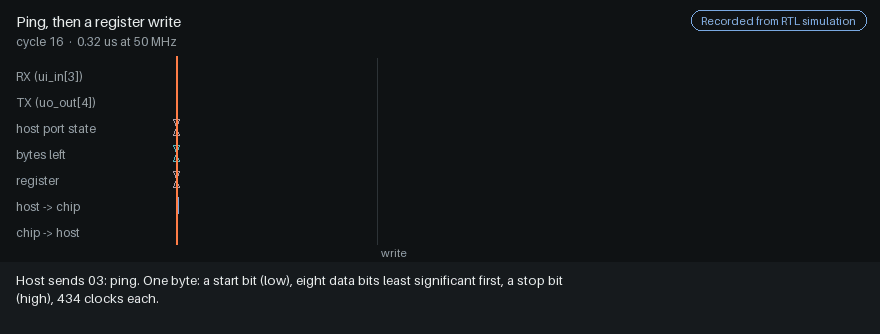

<sub>Recorded, not drawn: one window of `make -C test tour`, a simulation of the submitted top module
driven only through its pins, rendered by `docs/tools/readme_media.py`.
[Still image](docs/images/explorer/tour.png) for readers with motion turned off.</sub>

> **Tiqora-Serial was called TinyPulse-Serial until October 2026.** The serial protocol,
> register map and pin functions are unchanged.

> **Looking for the programmable microcontroller?** That is the main Tiqora project:
> [tiqora-skywater130](https://github.com/Normansrule/tiqora-skywater130), a RISC-V
> microcontroller you program in C, over USB serial or from flash, in 2 × 2 tiles (280 €).
> This repository, **tinytapeout-tiqora**, is its low-cost sibling: the same timing hardware
> with no CPU, driven by your computer, in 1 × 2 tiles (140 €).

The timestamping and trigger logic here is the same verified RTL (register-transfer level: the
hardware description a chip is built from) as the microcontroller's timing unit, byte for byte.
Instead of a RISC-V core running your program, a host computer sends it commands over a serial
port, through the demo board's USB (Universal Serial Bus) bridge. Use this one when the thinking happens on a PC, a Raspberry Pi or an
existing microcontroller, and you only need precise timing from the chip. Use the
microcontroller when the chip should run your code on its own.

It exists as tested RTL, not yet as a chip. The design synthesizes to 59% of the 1 × 2 die, but
place and route at 1 × 2 stops with `DPL-0036`; an experimental copy at 2 × 2 routes clean and
passes the Tiny Tapeout pre-flight. Which tile size to submit is the maintainer's decision.

**Key features**

- **Timestamps in hardware.** Edges on eight inputs are stamped with the 32-bit timebase, to the
  20 ns clock, and queued until the host reads them.
- **Triggers on the exact tick.** Three deadline outputs rise on the programmed tick, however
  busy the host is.
- **No processor to program.** Six-byte commands over 115,200 baud serial; a Python library and
  command line (`sw/tpctl.py`) do the talking.
- **Same timing unit as Tiqora**, checked byte for byte by `make -C test shared`.
- **Evidence on every number**: measured (with command and version), experimental, failed or not
  done yet.
- **An explorer you can open offline**: recorded tours, a protocol lab, a lab where you fire your
  own deadline, and a zoom from a grain of salt down to one flip-flop.

### Explore it

| Page | What you can do there |
|---|---|
| [**Overview**](https://normansrule.github.io/tinytapeout-tiqora/index.html) | fire a deadline of your own; scroll from a grain of salt down to one flip-flop; what goes in, what happens inside, what comes out, what is proven |
| [**Tours**](https://normansrule.github.io/tinytapeout-tiqora/tours.html) | six sequences recorded from the RTL, with play, step, scrub and captions; type your own command bytes and see the 8N1 frames and the reply |
| [**Chip atlas**](https://normansrule.github.io/tinytapeout-tiqora/atlas.html) | every block from the elaborated RTL: ports, legal values, behaviour, tests, connections you can follow |
| [**Physical design**](https://normansrule.github.io/tinytapeout-tiqora/physical.html) | measured cell area per block against the 1 × 2 die, and the experimental 2 × 2 layout |
| [**Evidence**](https://normansrule.github.io/tinytapeout-tiqora/evidence.html) | the ladder from RTL tests to silicon, with the command behind every rung |

The same pages are in `docs/site/` and open from a clone with no network.
The links above are the GitHub Pages copy, published by `.github/workflows/pages.yaml` on every push to
`main`; if it is not up, the same pages open [through htmlpreview](https://htmlpreview.github.io/?https://github.com/Normansrule/tinytapeout-tiqora/blob/main/docs/site/index.html).

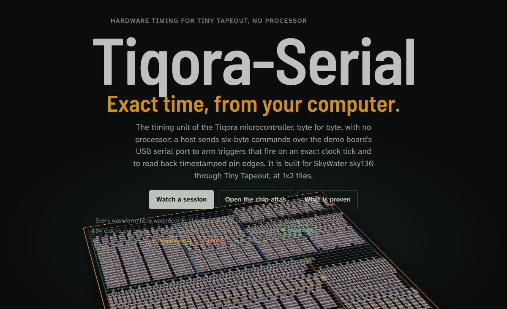

| Fire a deadline | The zoom's last view |
|---|---|
| 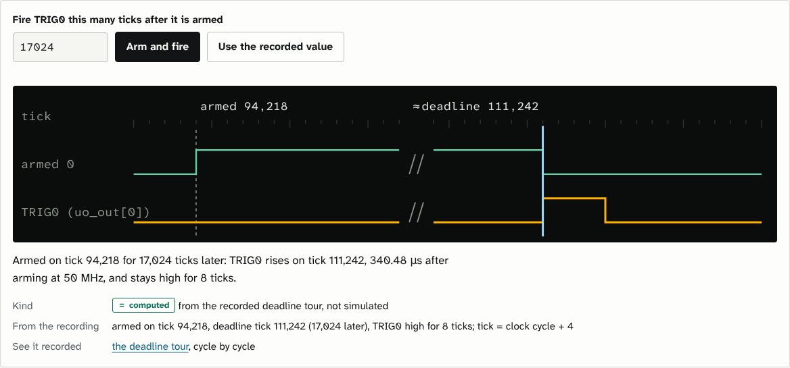 | 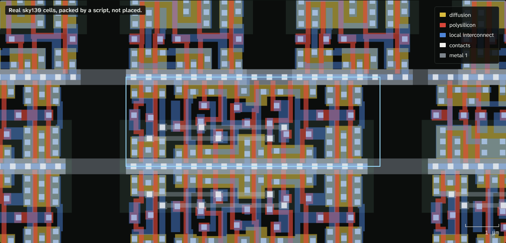 |

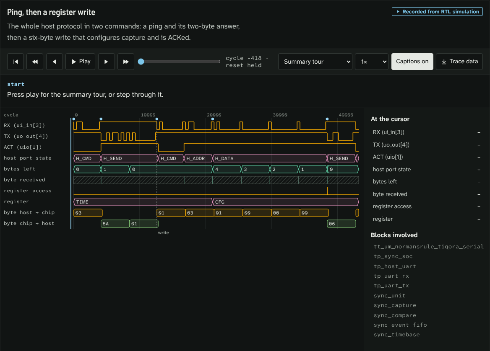

<sub>Photographed from the built pages by `docs/tools/site_shots.py`: the opening shot a little way into its scroll, the rest with reduced motion on.</sub>


**Contents:** [Status](#status) · [What it looks like](#what-it-looks-like) · [Run it on an FPGA today: Digilent Basys 3](#run-it-on-an-fpga-today-digilent-basys-3) · [Quick start](#quick-start) · [How you talk to it](#how-you-talk-to-it) · [Pin map](#pin-map) · [Serial protocol](#serial-protocol) · [Register map](#register-map) · [Host software](#host-software) · [Verification](#verification) · [Area](#area) · [Running the checks](#running-the-checks) · [Design](#design) · [Repository](#repository) · [Maintainer](#maintainer)

## Status

Where the Tiny Tapeout tile stands on the way to silicon. Each rung needs the one before it.

| Stage | State | Evidence |
|---|---|---|
| RTL tested | ✅ done | 30 checks, 5 cocotb tests from the pins, recorded tour 13/13 (`make -C test sim`; v20) |
| Formally checked | ⬜ not done | no formal proofs exist for this design |
| Synthesized | ✅ done | 21,324 µm², 458 flip-flops, 59% of the 1 × 2 die (`make -C test area`, Yosys 0.33; v20) |
| Placed and routed | ❌ failed at 1 × 2 | LibreLane 3.0.14 stops in detailed placement with `DPL-0036`. Experimental 2 × 2 copy: DRC 0, LVS 0, antenna 0 |
| Timing checked | ⬜ not at 1 × 2 | experimental 2 × 2 copy: setup +0.563 ns, hold +0.107 ns worst slack |
| Submitted, fabricated, measured | ⬜ not yet | the 2 × 2 copy passes the Tiny Tapeout pre-flight 15/15; submitting it means changing `info.yaml`'s tile count |
| FPGA board | ⬜ not yet | the Basys 3 design passes in simulation, 7 checks; nothing has run on a board |

<!-- progress:begin (generated by docs/tools/progress.py from docs/progress.json; do not edit) -->

### Progress

Where Tiqora-Serial stands on the way to silicon. Every ✅ and 🔄 below names the version and the command that measured it; re-run the command to check it.

| Milestone | Progress | Step | State | Evidence or next step |
|---|---|---|---|---|
| **FPGA simulation** | `██████████` 2/2 | RTL suites on the serial host port | ✅ | 30 checks and 5 cocotb tests pass; measured (v20, 2026-10-18, `make -C test sim`) |
|  |  | whole Basys 3 design in simulation | ✅ | 7 checks; measured (v20, 2026-10-18, `make -C fpga/basys3 sim`) |
| **Basys 3 board** | `░░░░░░░░░░` 0/2 | Vivado bitstream | ⬜ | next: make bit in fpga/basys3 on a machine with Vivado |
|  |  | running on a real board | ⬜ | next: make prog in fpga/basys3, then drive it from the PC at 115,200 baud |
| **Tiny Tapeout GDS and pre-flight** | `███░░░░░░░` 1/3 | cell area after synthesis, before placement | ✅ | 21,324 µm², 458 flip-flops: 59% of 1x2; measured (v20, Yosys 0.33, 2026-10-18, `make -C test area`) |
|  |  | place and route at 1x2 | ⛔ | next: LibreLane 3.0.14 stops at detailed placement (DPL-0036); a 2x2 copy hardens clean (DRC 0, LVS 0), so the tile size is the owner's call |
|  |  | Tiny Tapeout pre-flight | ⬜ | next: runs after a clean GDS at the chosen tile size; the 2x2 copy passed 15/15 |
| **sky130 timing** | `░░░░░░░░░░` 0/1 | signoff timing after routing | ⬜ | next: comes with a clean GDS; the 2x2 copy met setup and hold at every corner |
| **Silicon** | `░░░░░░░░░░` 0/2 | shuttle submission | ⬜ | next: after a clean GDS and pre-flight |
|  |  | first chip tested | ⬜ | next: after the shuttle returns |

✅ done · 🔄 in progress · ⬜ not started · ⛔ blocked. Only measured results count as done.

<!-- progress:end -->

## What it looks like

**Watch it run.** Every recorded tour also plays as an animation: a cursor sweeps the window
from caption to caption and uncovers the waveform the simulation wrote. This one is the whole
serial session; the others sit next to the part of this README they show
([Serial protocol](#serial-protocol) and [Register map](#register-map)).


<sub>Recorded from `make -C test tour` and drawn by `docs/tools/motion.py`. [Step through it](https://normansrule.github.io/tinytapeout-tiqora/tours.html#seq=overview). With reduced motion on, it is a still of the whole window.</sub>

**From the board to the silicon.** The chip would arrive in a QFN package on a carrier board that
plugs into the demo board; inside, every project on the shuttle shares one die behind a
multiplexer, and Tiqora-Serial is one 1 × 2 block of tiles on it:


**Where the area goes, to scale.** Each block's measured cell area from synthesis, laid out in
the real 161.00 × 225.76 µm die outline. A treemap of measured numbers, not a placement:


**An illustration, not a placement.** Every real sky130 cell of the synthesized design, drawn
with its real geometry but packed into rows block by block by a simple script
(`docs/tools/layout_preview.py`). The zoom animation (`docs/images/zoom.webp`,
`docs/tools/zoom_animation.py`) is drawn from the same illustration:


**One flip-flop, taken apart.** The design's 458 flip-flops are this cell. Its real manufacturing
layers separate and rejoin:


The only routed layout so far is the experimental 2 × 2 copy, shown with its sign-off numbers on
the [Physical design page](docs/site/physical.html).

## Run it on an FPGA today: Digilent Basys 3

The same RTL runs on a [Digilent Basys 3](fpga/basys3/README.md) (Artix-7) with nothing attached.
The board's USB port is the host link, so `sw/tpctl.py` works unchanged; the buttons are capture
inputs and the LEDs show the triggers and the event queue. `make sim` in `fpga/basys3` checks the
whole board design first (7 of 7), and `make bit && make prog` loads it with Vivado.

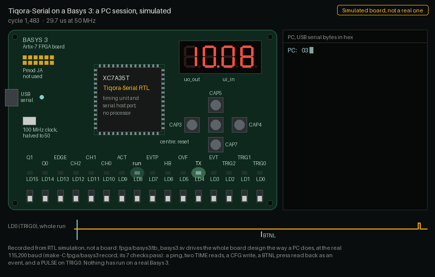

<sub>**Simulated, not a real board.** `make -C fpga/basys3 record` repeats `make sim`, the whole
board design in Icarus Verilog driven the way a PC drives it at the real 115,200 baud;
`fpga/basys3/rec_basys3.sv` writes down the LEDs, the 7-segment display, the buttons and the
serial bytes, and `docs/tools/fpga_media.py` draws them. Nothing has run on a real Basys 3 yet.
[Still image](docs/images/explorer/fpga.png) for readers with motion turned off.</sub>

## Quick start

```bash
pip install pyserial
cd sw
python3 tpctl.py --port /dev/ttyACM0 ping
python3 examples/01_hello.py /dev/ttyACM0
```

```python
from tpctl import Tiqora

tp = Tiqora("/dev/ttyACM0")
tp.configure_capture(enable=0xFF)              # timestamp all 8 inputs
tp.set_pulse_width(tp.ticks(1e-6))             # 1 us trigger pulses

tp.arm(channel=0, at=tp.time() + tp.ticks(0.010))   # fire in exactly 10 ms

for ev in tp.events():                          # stream timestamps
    print(ev)
```

Wiring, voltages and bring-up order: **[docs/HOOKUP.md](docs/HOOKUP.md)**.

---

## How you talk to it

The serial port uses the **Tiny Tapeout recommended UART pins**: RX on
`ui_in[3]`, TX on `uo_out[4]`. On the Tiny Tapeout demo board, the onboard
RP2040 bridges those pins to the board's USB-C port. Plug the demo board
into a computer and a serial port appears — no adapter, no wiring.

That is exactly how an ESP32 devkit works. The ESP32 has no USB transceiver
either; the devkit carries a USB-to-UART bridge wired to its serial pins.

Off the demo board, any 3.3 V USB-to-UART adapter works (CP2102, CH340,
FT232). Three wires:

```
   USB-UART adapter              Tiqora-Serial
   ----------------              -------------
   TXD  ──────────────────────►  ui_in[3]   RX
   RXD  ◄──────────────────────  uo_out[4]  TX
   GND  ───────────────────────  GND
```

**Use a 3.3 V adapter.** Tiny Tapeout I/O expects 3.3 V logic. A 5 V
adapter can damage the chip.

Serial settings: **8N1, no flow control, 115200 baud** at a 50 MHz tile
clock. The baud rate is `clk_hz / 434`, fixed in silicon, so a 25 MHz tile
clock gives 57,600 baud.

---

## Pin map

**Every pin, where it really is.** All 43 pins sit on metal 4 along the tile's top edge, at the
exact positions from Tiny Tapeout's 1 × 2 template; the band names each one:


**What each pin connects to:**


| Pin | Name | Dir | Function |
|---|---|---|---|
| `ui[0]` | CAP0 | in | Capture channel 0 |
| `ui[1]` | CAP1 | in | Capture channel 1 |
| `ui[2]` | CAP2 | in | Capture channel 2 |
| **`ui[3]`** | **RX** | **in** | **Serial from host — dedicated** |
| `ui[4]` | CAP3 | in | Capture channel 3 |
| `ui[5]` | CAP4 | in | Capture channel 4 |
| `ui[6]` | CAP5 | in | Capture channel 5 |
| `ui[7]` | CAP6 | in | Capture channel 6 |
| `uo[0]` | TRIG0 | out | Deadline trigger 0 |
| `uo[1]` | TRIG1 | out | Deadline trigger 1 |
| `uo[2]` | TRIG2 | out | Deadline trigger 2 |
| `uo[3]` | EVT | out | Event queue not empty |
| **`uo[4]`** | **TX** | **out** | **Serial to host — dedicated** |
| `uo[5]` | OVF | out | Event queue overflowed, sticky |
| `uo[6]` | HB | out | Heartbeat, timebase bit 23 (about 3 Hz at 50 MHz) |
| `uo[7]` | EVTP | out | One-clock pulse per captured event |
| `uio[0]` | CAP7 | in | Capture channel 7 |
| `uio[1]` | ACT | out | Serial activity — put an LED on it |
| `uio[4:2]` | EVCH | out | Channel of the event at the head of the queue |
| `uio[5]` | EVED | out | Edge of that event, 1 = rising |
| `uio[7:6]` | EVQ | out | Number of events queued |

The capture channels skip `ui[3]` because that pin is the serial input, so
channel numbers and physical pins don't line up above channel 2. CAP7 lives
on the bidirectional bank.

`EVCH`, `EVED` and `EVQ` cost nothing — they are signals the chip already
computes — and they let a logic analyser watch events arrive without the
host having to poll.

---

## Serial protocol

Least significant byte first throughout.

| Host sends | Chip replies | Meaning |
|---|---|---|
| `01 aa d0 d1 d2 d3` | `06` | Write the 32-bit value `d3d2d1d0` to register `aa` |
| `02 aa` | `d0 d1 d2 d3` | Read register `aa` |
| `03` | `5A 01` | Ping: magic byte, protocol version |
| anything else | `15` | Not acknowledged |

The chip is full duplex and begins replying as soon as it has sampled your
last stop bit, so your receiver must be listening independently of your
transmitter. Every hardware USB-UART adapter already works that way.

**A ping, then a register write**, byte by byte on the pins:


<sub>Recorded from `make -C test tour` and drawn by `docs/tools/motion.py`. [Step through it](https://normansrule.github.io/tinytapeout-tiqora/tours.html#seq=host-protocol). With reduced motion on, it is a still of the whole window.</sub>

**A read.** Two bytes in, four bytes out, least significant first; the value is the timebase on the clock the port touched the register:


<sub>Recorded from `make -C test tour` and drawn by `docs/tools/motion.py`. [Step through it](https://normansrule.github.io/tinytapeout-tiqora/tours.html#seq=read-time). With reduced motion on, it is a still of the whole window.</sub>

**Wrong bytes.** An unknown command gets `15`; a command cut off part way gets nothing, swallows the next one, and only reset recovers:


<sub>Recorded from `make -C test tour` and drawn by `docs/tools/motion.py`. [Step through it](https://normansrule.github.io/tinytapeout-tiqora/tours.html#seq=errors). With reduced motion on, it is a still of the whole window.</sub>

## Register map

Same map as the full chip. `aa` is the offset.

| `aa` | Name | R/W | Contents |
|---|---|---|---|
| 0 | TIME | R | Current 32-bit timebase |
| 1 | EVENT | R | Oldest queued event. **Reading pops it.** |
| 2 | STAT | R | Status word |
| 3 | CFG | W | Capture enable and edge selection |
| 4 | CMP0 | W | Arm trigger 0 at this timebase value |
| 5 | CMP1 | W | Arm trigger 1 at this timebase value |
| 7 | PW | W | Trigger pulse width in ticks |
| 8 | ADJ | W | Step the timebase by a signed amount |
| 9 | RATE | W | Fractional rate trim |
| 10 | PULSE | W | Fire the trigger channels in bits 2:0 now |

Trigger 2 has no register alias; in this build it is reachable only by
`PULSE`. Bit layouts for EVENT, STAT, CFG and RATE are identical to the full
chip — see its README.

---

**A deadline over serial.** Write `CMP0` and `TRIG0` rises on exactly that tick, with nothing on the wire:


<sub>Recorded from `make -C test tour` and drawn by `docs/tools/motion.py`. [Step through it](https://normansrule.github.io/tinytapeout-tiqora/tours.html#seq=deadline). With reduced motion on, it is a still of the whole window.</sub>

**An edge, queued and read.** A capture pin's edge becomes a timestamped event at once; a serial read pops it:


<sub>Recorded from `make -C test tour` and drawn by `docs/tools/motion.py`. [Step through it](https://normansrule.github.io/tinytapeout-tiqora/tours.html#seq=event). With reduced motion on, it is a still of the whole window.</sub>

## Host software

`sw/tpctl.py` is both a library and a command-line tool. It has no
dependencies beyond `pyserial`, and its protocol encoding is covered by a
self-test that runs with no hardware at all:

```bash
python3 sw/tpctl.py selftest          # 18 checks, no chip needed
```

### Command line

```bash
tpctl.py -p PORT ping                 # check the link
tpctl.py -p PORT time                 # read the timebase
tpctl.py -p PORT status               # decoded status word
tpctl.py -p PORT capture 0xFF         # enable all capture channels
tpctl.py -p PORT arm 0 0.010          # fire trigger 0 in 10 ms
tpctl.py -p PORT pulse 0b101          # fire triggers 0 and 2 now
tpctl.py -p PORT drain                # print queued events
tpctl.py -p PORT watch                # stream events until Ctrl-C
tpctl.py -p PORT read 2               # raw register read
tpctl.py -p PORT write 7 0x40         # raw register write
```

Add `--clock 25000000 --baud 57600` if you run the tile at another clock.

### Library

| Call | Does |
|---|---|
| `ping()` | Check the link, return the protocol version |
| `time()` | Current timebase in ticks |
| `ticks(seconds)` | Convert seconds to ticks at the configured clock |
| `configure_capture(enable, falling, both_edges)` | Which pins capture, and on which edge |
| `status()` | Decoded `Status`: queue depth, overflow, armed mask, live pin levels |
| `pop()` / `drain()` / `events()` | One event, all queued events, or a stream |
| `set_pulse_width(ticks)` | Trigger pulse width |
| `arm(channel, at)` | Fire a trigger on an exact timebase value |
| `pulse(mask)` | Fire trigger channels immediately |
| `step(delta_ticks)` | Jump the clock. Coarse; use once. |
| `trim(ppm)` | Slew the clock. Never makes a timestamp go backwards. |

`Event` decodes to `software`, `channel`, `rising`, `timestamp`.
`Status` decodes to `count`, `empty`, `full`, `overflow`, `armed`,
`triggers`, `levels`.

### Worked examples

| File | What it does |
|---|---|
| `examples/01_hello.py` | Prove the link, and sanity-check the baud rate against the clock |
| `examples/02_selfcal_latency.py` | Jumper TRIG0 to CAP0 and the chip measures its own capture latency |
| `examples/03_camera_sync.py` | Shutter at a fixed rate, timestamp the strobe and an IMU line, report the skew |
| `examples/04_discipline.py` | Lock the timebase to a one-pulse-per-second reference |
| `examples/05_logger.py` | Log every event to CSV |

`02_selfcal_latency.py` is the one to run first on real hardware. It
turns the chip's constant capture latency into a number you can subtract,
which is what makes the timestamps mean something at the pin rather than
at an internal flip-flop.

---

## Verification

| Check | Result |
|---|---|
| `tb_uart.sv`, driving only the serial pins | **30 / 30** |
| `test.py` cocotb, through the Tiny Tapeout pin interface | **5 / 5** |
| `tpctl.py selftest`, host protocol with no hardware | **18 / 18** |
| Verilator `-Wall` | **clean** (two documented waivers) |
| Yosys elaboration | **passes, no latches** |
| Shared sync blocks | **byte-identical** to the main Tiqora chip, checked by `make shared` against a SHA-256 manifest kept in both repositories |

The serial test does everything a host would: ping, reject garbage, read the
running timebase, configure capture, capture an edge and read the event back,
fire triggers, and arm a deadline. **The deadline armed over serial fires on
the exact programmed tick** — the same cycle-exact behaviour the full chip has (exact relative
to the supplied clock; oscillator error and pad delay are separate), checked through two pins.

What has *not* been done yet: a placed and routed layout at 1 × 2 (it stops with `DPL-0036`),
routed timing at 1 × 2, gate-level simulation, and a run on a real Basys 3. The area has been
measured against the real sky130 library; see [Area](#area).

---

## Area

**Measured**, not estimated. Yosys maps the design onto the real sky130_fd_sc_hd standard cell
library: 2,524 cells, 458 of them flip-flops, **20,400–21,300 µm²** depending on the Yosys version
(about 20,400 with 0.52, 21,324 with 0.33). The table is the 21,324 µm² measurement:

| Tile | At 60% utilisation | At 70% | Verdict |
|---|---:|---:|---|
| 1x1 | 198% | 170% | does not fit |
| **1x2** | **98%** | **84%** | **fits — this is the target** |
| 2x2 | 47% | 40% | plenty of room |

That is about 60% of the 1 × 2 tile's **placeable** area (161.00 × 225.76 µm minus the placement
margins), before the flow adds buffers. Tiny Tapeout's default placement density of 60 would sit
at or below the design's own utilization and fail with `GPL-0302`, so `src/config.json` sets 70 —
the same reasoning as the main Tiqora repository, which uses 72.

A 1x1 was the original goal and it is not reachable with this feature
set. The serial host port alone — receiver, transmitter and protocol
engine — is about 38% of a 1x1 tile, and the timebase, comparators and
event queue take more than the rest. Cutting to one trigger and a 16-bit
rate trim only got it to 160% of a 1x1.

A pre-PDK estimate put this at 21,345 um^2, 3% high, so the estimating
method is sound but no substitute for the real library.

One optimisation was tried and reverted. Rewriting the comparator's
`(now + 1) - deadline >= 0` as `now - deadline >= -1` looks like it saves
a 32-bit adder per channel. Measured, it was 1,000 um^2 **worse**:
synthesis already shares the single `now + 1` incrementer across all
three channels, while the rewrite needs a 32-input AND tree in each one.
The note is in `sync_compare.sv` so nobody tries it again.

**Reproduce it yourself:**

```bash
cd test
make area LIB=~/ttsetup/pdk/sky130A/libs.ref/sky130_fd_sc_hd/lib/sky130_fd_sc_hd__tt_025C_1v80.lib
```

That maps the design onto the real sky130 library and prints utilisation
for every tile size with a fits / tight / does not fit verdict. Set
`tiles` in `info.yaml` to the smallest size it calls "fits".

---

## Running the checks

```bash
cd test
make sim      # the serial host port testbench, the recorded tour, the docs and site checks
make tour     # only the recorded tour (13 checks); then python3 ../docs/tools/traces.py
make lint     # Verilator -Wall
make synth    # Yosys elaboration
make area LIB=<path>   # real sky130 area: cells, flip-flops, fit per tile size
make          # the cocotb tests, from the pins only (5 tests)
make -C ../fpga/basys3 sim   # the whole Basys 3 board design (7 checks)
```

Regenerate the images (from the repository root):

```bash
python3 -m pip install klayout pillow
python3 docs/tools/layout_preview.py ~/pdk/sky130A/libs.ref/sky130_fd_sc_hd    # cell-level layout
python3 docs/tools/zoom_animation.py                                           # the zoom
python3 docs/tools/datasheet_stills.py                                         # the zoom as stills, for the PDF
python3 docs/tools/exploded_cell.py ~/pdk/sky130A/libs.ref/sky130_fd_sc_hd "Every register in Tiqora-Serial is built from this cell."
python3 docs/tools/silicon_views.py                                            # pin map, packaging, connections
python3 docs/tools/motion.py                                                   # every tour as an animation (before build_site.py)
python3 docs/tools/atlas.py && python3 docs/tools/build_site.py                # the explorer site (atlas needs Yosys)
python3 docs/tools/readme_media.py                                             # the README animation
```

Any Yosys version works. `make area` prefers `~/oss-cad-suite/bin/yosys`
if you have it, and finds your sky130 library automatically.

## Design

The explorer site is meant to read like a logic analyser's capture, kept calm enough for long
reading. We call the direction **Scope**; it is shared, file for file, with
[Tiqora's explorer](https://github.com/Normansrule/tiqora-skywater130#design).

- **Time runs left to right.** A thin cycle ruler under the header marks each section as a tick
  and follows your place on the page. Recorded traces are amber; the cursor that marks "now",
  links and focus rings are one cool probe blue. Light mode is the capture printed on paper;
  dark mode is the instrument's screen.
- **Readable first.** Body text is Atkinson Hyperlegible Next and values are Atkinson
  Hyperlegible Mono, both drawn so that 0/O and 1/l/I never get confused. Headings use Barlow
  Semi Condensed, the lettering of an instrument's front panel. Lines stay around 56
  characters. All three fonts are SIL Open Font License files inlined into the pages.
- **Colour never carries meaning alone.** Every evidence label has a word and a drawn shape,
  every signal row and block has its name, and the block colours were checked for
  colour-vision deficiency in both themes.
- **Motion is physical and quiet.** The tour cursor and the deadline lab move on a critically
  damped spring: they arrive quickly and settle without bouncing. Buttons give a 0.97 press.
  With reduced motion turned on, everything jumps straight to its end state.
- **The overview opens like a product page.** The name, then the tile of real cells lying tilted
  in perspective; as you scroll the copy lifts away and the tile settles flat, straight into the
  zoom. Then four big numbers, each with how it was obtained. Scroll sets the target and the
  same spring follows it; with reduced motion the tile simply rests flat.
- **The Basys 3 board is a recording too, and it plays live.** On the overview you can play or
  drag through the recorded run (`docs/site/lib/board.js`); the README shows the same run as an
  animation. It looks like the board (green board, red 7-segment digits, green LEDs at their real
  duty cycle) but every frame comes from a simulation, and its corner says *Simulated board, not
  a real one*.
- **The zoom is drawn the way [Visual 6502](http://www.visual6502.org/) draws a die**: every
  layer as translucent colour on black. The cells and their geometry are this design's real
  sky130 cells (`docs/tools/die_map.py`); their positions come from a row packer, not a placer,
  and the page says so at every zoom level. No Visual 6502 code or data is used, only the idea
  of the view. With reduced motion it becomes four still views with buttons.
- **Honest about where numbers come from.** Labs say *computed* and link to the recording they
  are derived from; the zoom says *illustrative* where it is; nothing is drawn by hand.

Every page works without JavaScript as plain text, keeps its keyboard controls, and has no
horizontal scroll at phone width.

## Repository

```
src/sync/      the timing unit: timebase, capture, event queue, deadline comparators
               (byte-identical to Tiqora's, docs/shared_timing.sha256)
src/uart/      serial receiver, transmitter and the host port that decodes commands
src/tp_sync_soc.sv  the design;  tt_um_normansrule_tiqora_serial.sv  pin wrapper
src/config.json  hardening configuration
sw/            tpctl.py (host library and command line), examples/
test/          testbenches, the recorded tour, cocotb tests
fpga/basys3/   the Digilent Basys 3 build; rec_basys3.sv records a simulated run (make record)
docs/site/     the explorer site: pages/ (templates), lib/ (shared styles, scripts and fonts),
               data/ (atlas, tours, die map), and the built pages next to them
docs/fpga/     the recorded Basys 3 run behind the board animation
docs/tools/    atlas.py, traces.py, die_map.py, build_site.py, check_site.py, readme_media.py,
               motion.py, site_shots.py, fpga_media.py: the site and its README pictures; the other images' generators
syn/           synthesis and area scripts
```

## Maintainer

Maintained by [@Normansrule](https://github.com/Normansrule); see [MAINTAINERS.md](MAINTAINERS.md).

## Licence

Apache-2.0. The sky130 PDK is by SkyWater and Google; fabrication would be through Tiny Tapeout.
