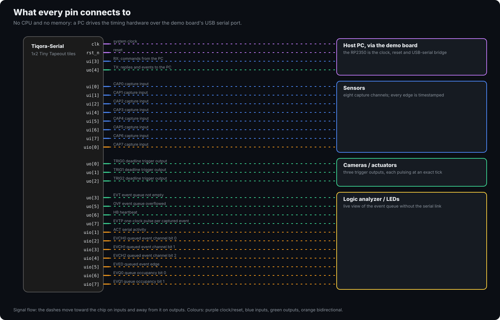

# Tiqora-Serial

**Hardware timestamping and cycle-exact triggers, controlled over USB serial — no CPU.**

> **Tiqora-Serial was called TinyPulse-Serial until October 2026.** The serial protocol,
> register map and pin functions are unchanged.


-e34c26)


<sub>From the 1 × 2 tile down to single transistors: the design's ~2,700 real sky130 cells, drawn
from SkyWater's own cell geometry with KLayout (`docs/tools/zoom_animation.py`).</sub>

> **Looking for the programmable microcontroller?** That is the main Tiqora project:
> [tiqora-skywater130](https://github.com/Normansrule/tiqora-skywater130), a RISC-V
> microcontroller you program in C, over USB serial or from flash, in 2 × 2 tiles (280 €).
> This repository, **tinytapeout-tiqora**, is its low-cost sibling: the same timing hardware
> with no CPU, driven by your computer, in 1 × 2 tiles (140 €).

The timestamping and trigger logic here is the same verified RTL as the microcontroller's timing
unit, byte for byte. Instead of a RISC-V core running your program, a host computer sends it
commands over a serial port. Use this one when the thinking happens on a PC, a Raspberry Pi or an
existing microcontroller, and you only need precise timing from the chip. Use the
microcontroller when the chip should run your code on its own.

> **Status: verified in simulation and at gate level. Measured 20,400–21,300 µm² against the real
> sky130 library (the range is between Yosys versions): a 1 × 2 tile (140 €), at about 60% of its
> placeable area.** A 1 × 1 is not achievable with this feature set — see [Area](#area).
> Reproduce with `make area`.

---

**Contents:** [Status](#status) · [What it looks like](#what-it-looks-like) · [Run it on an FPGA today: Digilent Basys 3](#run-it-on-an-fpga-today-digilent-basys-3) · [Quick start](#quick-start) · [How you talk to it](#how-you-talk-to-it) · [Pin map](#pin-map) · [Serial protocol](#serial-protocol) · [Register map](#register-map) · [Host software](#host-software) · [Verification](#verification) · [Area](#area) · [Running the checks](#running-the-checks) · [Licence](#licence)

## Status

| | |
|---|---|
| ✅ **RTL simulation** | 30 checks on the serial host port (`cd test && make sim`), plus 5 cocotb tests from the pins only |
| ✅ **FPGA (simulated)** | the whole Digilent Basys 3 design, driven like a PC at 115,200 baud: 7 checks (`make -C fpga/basys3 sim`) |
| ✅ **Tiny Tapeout pre-flight** | CI's own project checker passes: docs, ports, build configuration |
| ✅ **Docs** | every link, image, `make` target and script mentioned exists (`make docs`, part of `make sim`) |
| ⏳ **Hardening** | runs on GitHub after a push (`gds` workflow); placement density set to 70 for this design |
| ⏳ **FPGA board** | Vivado build and a real Basys 3: `make bit && make prog` in `fpga/basys3` |
| ⏳ **Silicon** | after submission to a Tiny Tapeout shuttle |

<!-- progress:begin (generated by docs/tools/progress.py from docs/progress.json; do not edit) -->

### Progress

Where Tiqora-Serial stands on the way to silicon. Every ✅ and 🔄 below names the version and the command that measured it; re-run the command to check it.

| Milestone | Progress | Step | State | Evidence or next step |
|---|---|---|---|---|
| **FPGA simulation** | `██████████` 2/2 | RTL suites on the serial host port | ✅ | 30 checks and 5 cocotb tests pass; measured (v20, 2026-10-18, `make -C test sim`) |
|  |  | whole Basys 3 design in simulation | ✅ | 7 checks; measured (v20, 2026-10-18, `make -C fpga/basys3 sim`) |
| **Basys 3 board** | `░░░░░░░░░░` 0/2 | Vivado bitstream | ⬜ | next: make bit in fpga/basys3 on a machine with Vivado |
|  |  | running on a real board | ⬜ | next: make prog in fpga/basys3, then drive it from the PC at 115,200 baud |
| **Tiny Tapeout GDS and pre-flight** | `███░░░░░░░` 1/3 | cell area after synthesis, before placement | ✅ | 21,324 µm², 458 flip-flops: 59% of 1x2; measured (v20, Yosys 0.33, 2026-10-18, `make -C test area`) |
|  |  | place and route at 1x2 | ⛔ | next: LibreLane 3.0.14 stops at detailed placement (DPL-0036); a 2x2 copy hardens clean (DRC 0, LVS 0), so the tile size is the owner's call |
|  |  | Tiny Tapeout pre-flight | ⬜ | next: runs after a clean GDS at the chosen tile size; the 2x2 copy passed 15/15 |
| **sky130 timing** | `░░░░░░░░░░` 0/1 | signoff timing after routing | ⬜ | next: comes with a clean GDS; the 2x2 copy met setup and hold at every corner |
| **Silicon** | `░░░░░░░░░░` 0/2 | shuttle submission | ⬜ | next: after a clean GDS and pre-flight |
|  |  | first chip tested | ⬜ | next: after the shuttle returns |

✅ done · 🔄 in progress · ⬜ not started · ⛔ blocked. Only measured results count as done.

<!-- progress:end -->

## What it looks like

**From the board to the silicon.** The chip arrives in a QFN package on a carrier board that
plugs into the demo board; inside, every project on the shuttle shares one die behind a
multiplexer, and Tiqora-Serial is one 1 × 2 block of tiles on it:


**The tile, block by block.** Every cell of the synthesized design, placed by block inside the
161.00 × 225.76 µm tile. The deadline comparators are the largest block; the UART is small:


**One flip-flop, taken apart.** The design's 458 flip-flops are this cell. Its real manufacturing
layers separate and rejoin:



The routed layout comes from the `gds` GitHub Actions run, which publishes it to this
repository's GitHub Pages (enable Settings → Pages → Source: GitHub Actions).

## Run it on an FPGA today: Digilent Basys 3

The same RTL runs on a [Digilent Basys 3](fpga/basys3/README.md) (Artix-7) with nothing attached.
The board's USB port is the host link, so `sw/tpctl.py` works unchanged; the buttons are capture
inputs and the LEDs show the triggers and the event queue. `make sim` in `fpga/basys3` checks the
whole board design first (7 of 7), and `make bit && make prog` loads it with Vivado.

## Quick start

```bash
pip install pyserial
cd sw
python3 tpctl.py --port /dev/ttyACM0 ping
python3 examples/01_hello.py /dev/ttyACM0
```

```python
from tpctl import Tiqora

tp = Tiqora("/dev/ttyACM0")
tp.configure_capture(enable=0xFF)              # timestamp all 8 inputs
tp.set_pulse_width(tp.ticks(1e-6))             # 1 us trigger pulses

tp.arm(channel=0, at=tp.time() + tp.ticks(0.010))   # fire in exactly 10 ms

for ev in tp.events():                          # stream timestamps
    print(ev)
```

Wiring, voltages and bring-up order: **[docs/HOOKUP.md](docs/HOOKUP.md)**.

---

## How you talk to it

The serial port uses the **Tiny Tapeout recommended UART pins**: RX on
`ui_in[3]`, TX on `uo_out[4]`. On the Tiny Tapeout demo board, the onboard
RP2040 bridges those pins to the board's USB-C port. Plug the demo board
into a computer and a serial port appears — no adapter, no wiring.

That is exactly how an ESP32 devkit works. The ESP32 has no USB transceiver
either; the devkit carries a USB-to-UART bridge wired to its serial pins.

Off the demo board, any 3.3 V USB-to-UART adapter works (CP2102, CH340,
FT232). Three wires:

```
   USB-UART adapter              Tiqora-Serial
   ----------------              -------------
   TXD  ──────────────────────►  ui_in[3]   RX
   RXD  ◄──────────────────────  uo_out[4]  TX
   GND  ───────────────────────  GND
```

**Use a 3.3 V adapter.** Tiny Tapeout I/O expects 3.3 V logic. A 5 V
adapter can damage the chip.

Serial settings: **8N1, no flow control, 115200 baud** at a 50 MHz tile
clock. The baud rate is `clk_hz / 434`, fixed in silicon, so a 25 MHz tile
clock gives 57,600 baud.

---

## Pin map

**Every pin, where it really is.** All 43 pins sit on metal 4 along the tile's top edge, at the
exact positions from Tiny Tapeout's 1 × 2 template; the band names each one:


**What each pin connects to:**




| Pin | Name | Dir | Function |
|---|---|---|---|
| `ui[0]` | CAP0 | in | Capture channel 0 |
| `ui[1]` | CAP1 | in | Capture channel 1 |
| `ui[2]` | CAP2 | in | Capture channel 2 |
| **`ui[3]`** | **RX** | **in** | **Serial from host — dedicated** |
| `ui[4]` | CAP3 | in | Capture channel 3 |
| `ui[5]` | CAP4 | in | Capture channel 4 |
| `ui[6]` | CAP5 | in | Capture channel 5 |
| `ui[7]` | CAP6 | in | Capture channel 6 |
| `uo[0]` | TRIG0 | out | Deadline trigger 0 |
| `uo[1]` | TRIG1 | out | Deadline trigger 1 |
| `uo[2]` | TRIG2 | out | Deadline trigger 2 |
| `uo[3]` | EVT | out | Event queue not empty |
| **`uo[4]`** | **TX** | **out** | **Serial to host — dedicated** |
| `uo[5]` | OVF | out | Event queue overflowed, sticky |
| `uo[6]` | HB | out | Heartbeat, timebase bit 23 (about 3 Hz at 50 MHz) |
| `uo[7]` | EVTP | out | One-clock pulse per captured event |
| `uio[0]` | CAP7 | in | Capture channel 7 |
| `uio[1]` | ACT | out | Serial activity — put an LED on it |
| `uio[4:2]` | EVCH | out | Channel of the event at the head of the queue |
| `uio[5]` | EVED | out | Edge of that event, 1 = rising |
| `uio[7:6]` | EVQ | out | Number of events queued |

The capture channels skip `ui[3]` because that pin is the serial input, so
channel numbers and physical pins don't line up above channel 2. CAP7 lives
on the bidirectional bank.

`EVCH`, `EVED` and `EVQ` cost nothing — they are signals the chip already
computes — and they let a logic analyser watch events arrive without the
host having to poll.

---

## Serial protocol

Least significant byte first throughout.

| Host sends | Chip replies | Meaning |
|---|---|---|
| `01 aa d0 d1 d2 d3` | `06` | Write the 32-bit value `d3d2d1d0` to register `aa` |
| `02 aa` | `d0 d1 d2 d3` | Read register `aa` |
| `03` | `5A 01` | Ping: magic byte, protocol version |
| anything else | `15` | Not acknowledged |

The chip is full duplex and begins replying as soon as it has sampled your
last stop bit, so your receiver must be listening independently of your
transmitter. Every hardware USB-UART adapter already works that way.

## Register map

Same map as the full chip. `aa` is the offset.

| `aa` | Name | R/W | Contents |
|---|---|---|---|
| 0 | TIME | R | Current 32-bit timebase |
| 1 | EVENT | R | Oldest queued event. **Reading pops it.** |
| 2 | STAT | R | Status word |
| 3 | CFG | W | Capture enable and edge selection |
| 4 | CMP0 | W | Arm trigger 0 at this timebase value |
| 5 | CMP1 | W | Arm trigger 1 at this timebase value |
| 7 | PW | W | Trigger pulse width in ticks |
| 8 | ADJ | W | Step the timebase by a signed amount |
| 9 | RATE | W | Fractional rate trim |
| 10 | PULSE | W | Fire the trigger channels in bits 2:0 now |

Trigger 2 has no register alias; in this build it is reachable only by
`PULSE`. Bit layouts for EVENT, STAT, CFG and RATE are identical to the full
chip — see its README.

---

## Host software

`sw/tpctl.py` is both a library and a command-line tool. It has no
dependencies beyond `pyserial`, and its protocol encoding is covered by a
self-test that runs with no hardware at all:

```bash
python3 sw/tpctl.py selftest          # 18 checks, no chip needed
```

### Command line

```bash
tpctl.py -p PORT ping                 # check the link
tpctl.py -p PORT time                 # read the timebase
tpctl.py -p PORT status               # decoded status word
tpctl.py -p PORT capture 0xFF         # enable all capture channels
tpctl.py -p PORT arm 0 0.010          # fire trigger 0 in 10 ms
tpctl.py -p PORT pulse 0b101          # fire triggers 0 and 2 now
tpctl.py -p PORT drain                # print queued events
tpctl.py -p PORT watch                # stream events until Ctrl-C
tpctl.py -p PORT read 2               # raw register read
tpctl.py -p PORT write 7 0x40         # raw register write
```

Add `--clock 25000000 --baud 57600` if you run the tile at another clock.

### Library

| Call | Does |
|---|---|
| `ping()` | Check the link, return the protocol version |
| `time()` | Current timebase in ticks |
| `ticks(seconds)` | Convert seconds to ticks at the configured clock |
| `configure_capture(enable, falling, both_edges)` | Which pins capture, and on which edge |
| `status()` | Decoded `Status`: queue depth, overflow, armed mask, live pin levels |
| `pop()` / `drain()` / `events()` | One event, all queued events, or a stream |
| `set_pulse_width(ticks)` | Trigger pulse width |
| `arm(channel, at)` | Fire a trigger on an exact timebase value |
| `pulse(mask)` | Fire trigger channels immediately |
| `step(delta_ticks)` | Jump the clock. Coarse; use once. |
| `trim(ppm)` | Slew the clock. Never makes a timestamp go backwards. |

`Event` decodes to `software`, `channel`, `rising`, `timestamp`.
`Status` decodes to `count`, `empty`, `full`, `overflow`, `armed`,
`triggers`, `levels`.

### Worked examples

| File | What it does |
|---|---|
| `examples/01_hello.py` | Prove the link, and sanity-check the baud rate against the clock |
| `examples/02_selfcal_latency.py` | Jumper TRIG0 to CAP0 and the chip measures its own capture latency |
| `examples/03_camera_sync.py` | Shutter at a fixed rate, timestamp the strobe and an IMU line, report the skew |
| `examples/04_discipline.py` | Lock the timebase to a one-pulse-per-second reference |
| `examples/05_logger.py` | Log every event to CSV |

`02_selfcal_latency.py` is the one to run first on real hardware. It
turns the chip's constant capture latency into a number you can subtract,
which is what makes the timestamps mean something at the pin rather than
at an internal flip-flop.

---

## Verification

| Check | Result |
|---|---|
| `tb_uart.sv`, driving only the serial pins | **30 / 30** |
| `test.py` cocotb, through the Tiny Tapeout pin interface | **5 / 5** |
| `tpctl.py selftest`, host protocol with no hardware | **18 / 18** |
| Verilator `-Wall` | **clean** (two documented waivers) |
| Yosys elaboration | **passes, no latches** |
| Shared sync blocks | **byte-identical** to the main Tiqora chip, checked by `make shared` against a SHA-256 manifest kept in both repositories |

The serial test does everything a host would: ping, reject garbage, read the
running timebase, configure capture, capture an edge and read the event back,
fire triggers, and arm a deadline. **The deadline armed over serial fires on
the exact programmed tick** — the same cycle-exact behaviour the full chip has (exact relative
to the supplied clock; oscillator error and pad delay are separate), checked through two pins.

What has *not* been done yet: hardening and routed timing (the `gds` workflow on GitHub),
gate-level simulation, and a run on a real Basys 3. The area has been measured against the real
sky130 library; see [Area](#area).

---

## Area

**Measured**, not estimated. Yosys maps the design onto the real sky130_fd_sc_hd standard cell
library: 2,524 cells, 458 of them flip-flops, **20,400–21,300 µm²** depending on the Yosys version
(about 20,400 with 0.52, 21,324 with 0.33). The table is the 21,324 µm² measurement:

| Tile | At 60% utilisation | At 70% | Verdict |
|---|---:|---:|---|
| 1x1 | 198% | 170% | does not fit |
| **1x2** | **98%** | **84%** | **fits — this is the target** |
| 2x2 | 47% | 40% | plenty of room |

That is about 60% of the 1 × 2 tile's **placeable** area (161.00 × 225.76 µm minus the placement
margins), before the flow adds buffers. Tiny Tapeout's default placement density of 60 would sit
at or below the design's own utilization and fail with `GPL-0302`, so `src/config.json` sets 70 —
the same reasoning as the main Tiqora repository, which uses 72.

A 1x1 was the original goal and it is not reachable with this feature
set. The serial host port alone — receiver, transmitter and protocol
engine — is about 38% of a 1x1 tile, and the timebase, comparators and
event queue take more than the rest. Cutting to one trigger and a 16-bit
rate trim only got it to 160% of a 1x1.

A pre-PDK estimate put this at 21,345 um^2, 3% high, so the estimating
method is sound but no substitute for the real library.

One optimisation was tried and reverted. Rewriting the comparator's
`(now + 1) - deadline >= 0` as `now - deadline >= -1` looks like it saves
a 32-bit adder per channel. Measured, it was 1,000 um^2 **worse**:
synthesis already shares the single `now + 1` incrementer across all
three channels, while the rewrite needs a 32-input AND tree in each one.
The note is in `sync_compare.sv` so nobody tries it again.

**Reproduce it yourself:**

```bash
cd test
make area LIB=~/ttsetup/pdk/sky130A/libs.ref/sky130_fd_sc_hd/lib/sky130_fd_sc_hd__tt_025C_1v80.lib
```

That maps the design onto the real sky130 library and prints utilisation
for every tile size with a fits / tight / does not fit verdict. Set
`tiles` in `info.yaml` to the smallest size it calls "fits".

---

## Running the checks

```bash
cd test
make sim      # the serial host port testbench
make lint     # Verilator -Wall
make synth    # Yosys elaboration
make area LIB=<path>   # real sky130 area: cells, flip-flops, fit per tile size
make          # the cocotb tests, from the pins only (5 tests)
make -C ../fpga/basys3 sim   # the whole Basys 3 board design (7 checks)
```

Regenerate the images (from the repository root):

```bash
python3 -m pip install klayout pillow
python3 docs/tools/layout_preview.py ~/pdk/sky130A/libs.ref/sky130_fd_sc_hd    # cell-level layout
python3 docs/tools/zoom_animation.py                                           # the zoom
python3 docs/tools/exploded_cell.py ~/pdk/sky130A/libs.ref/sky130_fd_sc_hd "Every register in Tiqora-Serial is built from this cell."
python3 docs/tools/silicon_views.py                                            # pin map, packaging, connections
```

Any Yosys version works. `make area` prefers `~/oss-cad-suite/bin/yosys`
if you have it, and finds your sky130 library automatically.

## Licence

Apache-2.0.

Maintained by [@Normansrule](https://github.com/Normansrule) ([MAINTAINERS.md](MAINTAINERS.md)).
