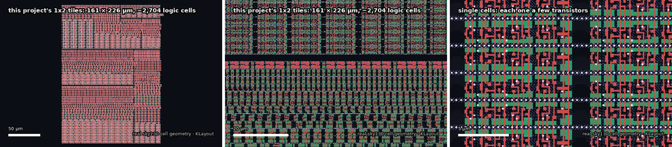

# Tiqora-Serial

**Hardware timestamping and cycle-exact triggers, controlled over USB serial — no CPU.**

> **Tiqora-Serial was called TinyPulse-Serial until October 2026.** The serial protocol,
> register map and pin functions are unchanged.

**Tiny Tapeout 1×2 tiles · SkyWater 130 nm · runs on a Basys 3 FPGA (Artix-7)**



<sub>From the 1 × 2 tile down to single transistors: the design's ~2,700 real sky130 cells, drawn
from SkyWater's own cell geometry with KLayout (`docs/tools/zoom_animation.py`, stills by `docs/tools/datasheet_stills.py`).</sub>

> **Looking for the programmable microcontroller?** That is the main Tiqora project:
> [tiqora-skywater130](https://github.com/Normansrule/tiqora-skywater130), a RISC-V
> microcontroller you program in C, over USB serial or from flash, in 3 × 2 tiles (420 €).
> This repository, **tinytapeout-tiqora**, is its low-cost sibling: the same timing hardware
> with no CPU, driven by your computer, in 1 × 2 tiles (140 €).

The timestamping and trigger logic here is the same verified RTL as the microcontroller's timing
unit, byte for byte. Instead of a RISC-V core running your program, a host computer sends it
commands over a serial port. Use this one when the thinking happens on a PC, a Raspberry Pi or an
existing microcontroller, and you only need precise timing from the chip. Use the
microcontroller when the chip should run your code on its own.

> **Status: verified in RTL simulation; not yet placed and routed at 1 × 2. Measured 20,400–21,300 µm² against the real
> sky130 library (the range is between Yosys versions): a 1 × 2 tile (140 €), at about 60% of its
> placeable area.** A 1 × 1 is not achievable with this feature set — see the Area section.
> Reproduce with `make area`.

---


## Status

| | |
|---|---|
| ✅ **RTL simulation** | 59 checks: 56 on the serial host port, 26 of them on framing errors, unknown commands, partial frames, late bytes, queue loss and reconnection, and 3 comparing the timing unit with a reference model (`cd test && make sim`), plus 5 cocotb tests from the pins only |
| ✅ **FPGA (simulated)** | the whole Digilent Basys 3 design, driven like a PC at 115,200 baud: 7 checks (`make -C fpga/basys3 sim`) |
| ✅ **Area (main 2026-10-25)** | 21,324 µm², 458 flip-flops, 59% of the 1 × 2 die (`make area`) |
| ✅ **Docs** | every link, image, `make` target and script mentioned exists (`make docs`, part of `make sim`) |
| ✅ **Place and route at 1 × 2** | the Tiny Tapeout `gds`, pre-flight and gate-level workflows pass (GitHub run 40161260168); local LibreLane 3.0.14 run: DRC 0, LVS 0, antenna 0 |
| ❌ **Setup timing, slow corner** | misses by 1.30 ns at 50 MHz at ss_100C_1v60 (29 paths), about 47 MHz there; met at the typical corner (+9.48 ns); hold met everywhere |
| ⏳ **FPGA board** | Vivado build and a real Basys 3: `make bit && make prog` in `fpga/basys3` |
| ⏳ **Silicon** | after submission to a Tiny Tapeout shuttle |

## What it looks like

**From the board to the silicon.** The chip arrives in a QFN package on a carrier board that
plugs into the demo board; inside, every project on the shuttle shares one die behind a
multiplexer, and Tiqora-Serial is one 1 × 2 block of tiles on it:


**An illustration, not a placement.** Every real sky130 cell of the synthesized design, drawn
with its real geometry but packed into rows block by block by a simple script
(`docs/tools/layout_preview.py`) inside the 161.00 × 225.76 µm tile. The deadline comparators
are the largest block; the UART is small:


**One flip-flop, taken apart.** The design's 458 flip-flops are this cell. Its real manufacturing
layers separate and rejoin:


The explorer site, `docs/site/physical.html`, shows the routed 1 × 2 layout with its sign-off
numbers.

## Run it on an FPGA today: Digilent Basys 3

The same RTL runs on a [Digilent Basys 3](../fpga/basys3/README.md) (Artix-7) with nothing attached.
The board's USB port is the host link, so `sw/tpctl.py` works unchanged; the buttons are capture
inputs and the LEDs show the triggers and the event queue. `make sim` in `fpga/basys3` checks the
whole board design first (7 of 7), and `make bit && make prog` loads it with Vivado.

## Quick start

```bash
pip install pyserial
cd sw
python3 tpctl.py --port /dev/ttyACM0 ping
python3 examples/01_hello.py /dev/ttyACM0
```

```python
from tpctl import Tiqora

tp = Tiqora("/dev/ttyACM0")
tp.configure_capture(enable=0xFF)              # timestamp all 8 inputs
tp.set_pulse_width(tp.ticks(1e-6))             # 1 us trigger pulses

tp.arm(channel=0, at=tp.time() + tp.ticks(0.010))   # fire in exactly 10 ms

for ev in tp.events():                          # stream timestamps
    print(ev)
```

Wiring, voltages and bring-up order: **[docs/HOOKUP.md](../docs/HOOKUP.md)**.

---

## How you talk to it

The serial port uses the **Tiny Tapeout recommended UART pins**: RX on
`ui_in[3]`, TX on `uo_out[4]`. On the Tiny Tapeout demo board, the onboard
RP2040 bridges those pins to the board's USB-C port. Plug the demo board
into a computer and a serial port appears — no adapter, no wiring.

That is exactly how an ESP32 devkit works. The ESP32 has no USB transceiver
either; the devkit carries a USB-to-UART bridge wired to its serial pins.

Off the demo board, any 3.3 V USB-to-UART adapter works (CP2102, CH340,
FT232). Three wires:

```
   USB-UART adapter              Tiqora-Serial
   ----------------              -------------
   TXD  ──────────────────────►  ui_in[3]   RX
   RXD  ◄──────────────────────  uo_out[4]  TX
   GND  ───────────────────────  GND
```

**Use a 3.3 V adapter.** Tiny Tapeout I/O expects 3.3 V logic. A 5 V
adapter can damage the chip.

Serial settings: **8N1, no flow control, 115200 baud** at a 50 MHz tile
clock. The baud rate is `clk_hz / 434`, fixed in silicon, so a 25 MHz tile
clock gives 57,600 baud.

---

## Pin map

**Every pin, where it really is.** All 43 pins sit on metal 4 along the tile's top edge, at the
exact positions from Tiny Tapeout's 1 × 2 template; the band names each one:


**What each pin connects to:**


| Pin | Name | Dir | Function |
|---|---|---|---|
| `ui[0]` | CAP0 | in | Capture channel 0 |
| `ui[1]` | CAP1 | in | Capture channel 1 |
| `ui[2]` | CAP2 | in | Capture channel 2 |
| **`ui[3]`** | **RX** | **in** | **Serial from host — dedicated** |
| `ui[4]` | CAP3 | in | Capture channel 3 |
| `ui[5]` | CAP4 | in | Capture channel 4 |
| `ui[6]` | CAP5 | in | Capture channel 5 |
| `ui[7]` | CAP6 | in | Capture channel 6 |
| `uo[0]` | TRIG0 | out | Deadline trigger 0 |
| `uo[1]` | TRIG1 | out | Deadline trigger 1 |
| `uo[2]` | TRIG2 | out | Deadline trigger 2 |
| `uo[3]` | EVT | out | Event queue not empty |
| **`uo[4]`** | **TX** | **out** | **Serial to host — dedicated** |
| `uo[5]` | OVF | out | Event queue overflowed, sticky |
| `uo[6]` | HB | out | Heartbeat, timebase bit 23 (about 3 Hz at 50 MHz) |
| `uo[7]` | EVTP | out | One-clock pulse per captured event |
| `uio[0]` | CAP7 | in | Capture channel 7 |
| `uio[1]` | ACT | out | Serial activity — put an LED on it |
| `uio[4:2]` | EVCH | out | Channel of the event at the head of the queue |
| `uio[5]` | EVED | out | Edge of that event, 1 = rising |
| `uio[7:6]` | EVQ | out | Number of events queued |

The capture channels skip `ui[3]` because that pin is the serial input, so
channel numbers and physical pins don't line up above channel 2. CAP7 lives
on the bidirectional bank.

`EVCH`, `EVED` and `EVQ` cost nothing — they are signals the chip already
computes — and they let a logic analyser watch events arrive without the
host having to poll.

---

## Serial protocol

Least significant byte first throughout.

| Host sends | Chip replies | Meaning |
|---|---|---|
| `01 aa d0 d1 d2 d3` | `06` | Write the 32-bit value `d3d2d1d0` to register `aa` |
| `02 aa` | `d0 d1 d2 d3` | Read register `aa` |
| `03` | `5A 01` | Ping: magic byte, protocol version |
| anything else | `15` | Not acknowledged |

The chip is full duplex and begins replying as soon as it has sampled your
last stop bit, so your receiver must be listening independently of your
transmitter. Every hardware USB-UART adapter already works that way.

## Register map

Same map as the full chip. `aa` is the offset.

| `aa` | Name | R/W | Contents |
|---|---|---|---|
| 0 | TIME | R | Current 32-bit timebase |
| 1 | EVENT | R | Oldest queued event. **Reading pops it.** |
| 2 | STAT | R | Status word |
| 3 | CFG | W | Capture enable and edge selection |
| 4 | CMP0 | W | Arm trigger 0 at this timebase value |
| 5 | CMP1 | W | Arm trigger 1 at this timebase value |
| 7 | PW | W | Trigger pulse width in ticks |
| 8 | ADJ | W | Step the timebase by a signed amount |
| 9 | RATE | W | Fractional rate trim |
| 10 | PULSE | W | Fire the trigger channels in bits 2:0 now |

Trigger 2 has no register alias; in this build it is reachable only by
`PULSE`. Bit layouts for EVENT, STAT, CFG and RATE are identical to the full
chip — see its README.

---

## Host software

`sw/tpctl.py` is both a library and a command-line tool. It has no
dependencies beyond `pyserial`, and its protocol encoding is covered by a
self-test that runs with no hardware at all:

```bash
python3 sw/tpctl.py selftest          # 18 checks, no chip needed
```

### Command line

```bash
tpctl.py -p PORT ping                 # check the link
tpctl.py -p PORT time                 # read the timebase
tpctl.py -p PORT status               # decoded status word
tpctl.py -p PORT capture 0xFF         # enable all capture channels
tpctl.py -p PORT arm 0 0.010          # fire trigger 0 in 10 ms
tpctl.py -p PORT pulse 0b101          # fire triggers 0 and 2 now
tpctl.py -p PORT drain                # print queued events
tpctl.py -p PORT watch                # stream events until Ctrl-C
tpctl.py -p PORT read 2               # raw register read
tpctl.py -p PORT write 7 0x40         # raw register write
```

Add `--clock 25000000 --baud 57600` if you run the tile at another clock.

### Library

| Call | Does |
|---|---|
| `ping()` | Check the link, return the protocol version |
| `time()` | Current timebase in ticks |
| `ticks(seconds)` | Convert seconds to ticks at the configured clock |
| `configure_capture(enable, falling, both_edges)` | Which pins capture, and on which edge |
| `status()` | Decoded `Status`: queue depth, overflow, armed mask, live pin levels |
| `pop()` / `drain()` / `events()` | One event, all queued events, or a stream |
| `set_pulse_width(ticks)` | Trigger pulse width |
| `arm(channel, at)` | Fire a trigger on an exact timebase value |
| `pulse(mask)` | Fire trigger channels immediately |
| `step(delta_ticks)` | Jump the clock. Coarse; use once. |
| `trim(ppm)` | Slew the clock. Never makes a timestamp go backwards. |

`Event` decodes to `software`, `channel`, `rising`, `timestamp`.
`Status` decodes to `count`, `empty`, `full`, `overflow`, `armed`,
`triggers`, `levels`.

### Worked examples

| File | What it does |
|---|---|
| `examples/01_hello.py` | Prove the link, and sanity-check the baud rate against the clock |
| `examples/02_selfcal_latency.py` | Jumper TRIG0 to CAP0 and the chip measures its own capture latency |
| `examples/03_camera_sync.py` | Shutter at a fixed rate, timestamp the strobe and an IMU line, report the skew |
| `examples/04_discipline.py` | Lock the timebase to a one-pulse-per-second reference |
| `examples/05_logger.py` | Log every event to CSV |

`02_selfcal_latency.py` is the one to run first on real hardware. It
turns the chip's constant capture latency into a number you can subtract,
which is what makes the timestamps mean something at the pin rather than
at an internal flip-flop.

---

## Verification

| Check | Result |
|---|---|
| `tb_uart.sv`, driving only the serial pins | **30 / 30** |
| `tb_proto.sv`, framing errors, glitches, all 253 unknown commands, partial frames, unmapped addresses, late bytes | **18 / 18** |
| `test.py` cocotb, through the Tiny Tapeout pin interface | **5 / 5** |
| `tpctl.py selftest`, host protocol with no hardware | **18 / 18** |
| Verilator `-Wall` | **clean** (two documented waivers) |
| Yosys elaboration | **passes, no latches** |
| Shared sync blocks | **byte-identical** to the main Tiqora chip, checked by `make shared` against a SHA-256 manifest kept in both repositories |

The serial test does everything a host would: ping, reject garbage, read the
running timebase, configure capture, capture an edge and read the event back,
fire triggers, and arm a deadline. **The deadline armed over serial fires on
the exact programmed tick** — the same cycle-exact behaviour the full chip has (exact relative
to the supplied clock; oscillator error and pad delay are separate), checked through two pins.

`tb_proto.sv` checks the port when the line or the host misbehaves (measured, main 2026-10-25,
`make -C test proto`, 7 of 7 RTL mutants caught). A byte with a low stop bit is dropped, and a
glitch under half a bit is not a byte. Every command byte other than 0x01, 0x02 and 0x03 gets one
NAK. A write reaches the registers in a single clock with all 32 bits, and only after its sixth
byte. Reads of offsets 3 to 15 return 0, and writes to the unmapped offsets 6 and 11 to 15 are
acknowledged and change nothing. Only the low four address bits are decoded.

Two limits follow from the design and are now measured rather than assumed:

* **Wait for each reply.** Bytes that arrive while the chip is still sending are ignored, so a
  host that sends its next command early loses it. `tpctl.py` always waits.
* **There is no frame timeout.** If a host stops partway through a frame, the chip keeps waiting,
  and the next bytes it receives finish that frame. A write cut short and followed by new commands
  commits those bytes as its data. After a host-side timeout, reset the chip, or send the missing
  bytes of a frame you know the state of, before trusting the link again.

What has *not* been done yet: setup timing at the slow corner (it misses by 1.30 ns at 50 MHz),
and a run on a real Basys 3. The area has been measured against the real
sky130 library; see the Area section.

---

## Area

**Measured**, not estimated. Yosys maps the design onto the real sky130_fd_sc_hd standard cell
library, minus the cells this design's flow excludes (`src/synth_exclude.cells`: the PDK's
`no_synth.cells` without its drive-strength-1 entries): 2,524 cells, 458 of them flip-flops,
**21,324 µm²** (measured, main 2026-10-25, Yosys 0.33, `make -C test area`).

| Tile | At 60% utilisation | At 70% | Verdict |
|---|---:|---:|---|
| 1x1 | 198% | 170% | does not fit |
| **1x2** | **98%** | **84%** | **fits: this is what it submits** |
| 2x2 | 47% | 40% | plenty of room |

That is 59% of the 1 × 2 die before the flow adds buffers, taps and clock tree; after placement
the cells fill 80% of the core (local LibreLane 3.0.14 run). With the PDK's default list, which
also bans the drive-strength-1 cells, the same design is 25,033 µm², 69% of the die, and placement
fails with `DPL-0036`. That is why `src/config.json` points LibreLane at `src/synth_exclude.cells`.

A 1x1 was the original goal and it is not reachable with this feature
set. The serial host port alone — receiver, transmitter and protocol
engine — is about 38% of a 1x1 tile, and the timebase, comparators and
event queue take more than the rest. Cutting to one trigger and a 16-bit
rate trim only got it to 160% of a 1x1.

A pre-PDK estimate put this at 21,345 um^2, within 0.1% of the measured
number, but only because the flow's cell list allows the small cells: with
the PDK's default list it is 17% low. No substitute for the real library.

One optimisation was tried and reverted. Rewriting the comparator's
`(now + 1) - deadline >= 0` as `now - deadline >= -1` looks like it saves
a 32-bit adder per channel. Measured, it was 1,000 um^2 **worse**:
synthesis already shares the single `now + 1` incrementer across all
three channels, while the rewrite needs a 32-input AND tree in each one.
The note is in `sync_compare.sv` so nobody tries it again.

**Reproduce it yourself:**

```bash
cd test
make area LIB=~/ttsetup/pdk/sky130A/libs.ref/sky130_fd_sc_hd/lib/sky130_fd_sc_hd__tt_025C_1v80.lib
```

That maps the design onto the real sky130 library and prints utilisation
for every tile size with a fits / tight / does not fit verdict. Set
`tiles` in `info.yaml` to the smallest size it calls "fits".

---

## Running the checks

```bash
cd test
make sim      # the serial host port testbench
make lint     # Verilator -Wall
make synth    # Yosys elaboration
make area LIB=<path>   # real sky130 area: cells, flip-flops, fit per tile size
make          # the cocotb tests, from the pins only (5 tests)
make -C ../fpga/basys3 sim   # the whole Basys 3 board design (7 checks)
```

Regenerate the images (from the repository root):

```bash
python3 -m pip install klayout pillow
python3 docs/tools/layout_preview.py ~/pdk/sky130A/libs.ref/sky130_fd_sc_hd    # cell-level layout
python3 docs/tools/zoom_animation.py                                           # the zoom
python3 docs/tools/datasheet_stills.py                                         # the zoom as stills, for the PDF
python3 docs/tools/exploded_cell.py ~/pdk/sky130A/libs.ref/sky130_fd_sc_hd "Every register in Tiqora-Serial is built from this cell."
python3 docs/tools/silicon_views.py                                            # pin map, packaging, connections
```

Any Yosys version works. `make area` prefers `~/oss-cad-suite/bin/yosys`
if you have it, and finds your sky130 library automatically.

## Licence

Apache-2.0.
